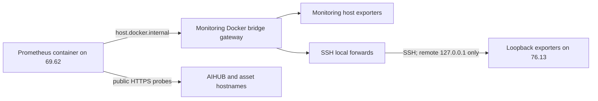

# AIHUB host and dependency observability

This is the candidate deployment record for #474. It does not replace the alert catalog owned by #412 and has not been installed on either shared host.

## Current inventory

Read-only inspection on 2026-10-15 found:

| Surface                        | Observation                                                                                                                                                                                                                                                                               | Remaining check                                                                                                                                                                                                                          |
| ------------------------------ | ----------------------------------------------------------------------------------------------------------------------------------------------------------------------------------------------------------------------------------------------------------------------------------------- | ---------------------------------------------------------------------------------------------------------------------------------------------------------------------------------------------------------------------------------------- |
| Monitoring host `69.62.74.196` | Read-only inspection found Prometheus `v3.13.4`, Grafana `12.4.11`, Tempo `2.10.8`, and Alertmanager `v0.34.1`. Prometheus has only Alertmanager and three bot jobs active; there are no AIHUB targets. Prometheus has no host-published port; Grafana and Alertmanager bind to loopback. | The monitoring configuration is operator-managed outside this repository, and its canonical writable Git worktree is not identified. Clarify the source-of-truth/worktree before changing it; then register AIHUB targets via #237/#412. |
| AIHUB host `76.13.218.96`      | `aihub-db` publishes `127.0.0.1:5433`; `dashboard_backend` publishes `127.0.0.1:8000`; `s3-vps-watchdog` uses host networking.                                                                                                                                                            | Shared-host owners must audit both containers' source and collection behavior.                                                                                                                                                           |
| `dashboard_backend`            | Host-side `GET /metrics` returned 404.                                                                                                                                                                                                                                                    | Do not assume it exports metrics on another path.                                                                                                                                                                                        |
| `s3-vps-watchdog`              | No metrics port was observed.                                                                                                                                                                                                                                                             | Its source and any local health endpoint remain unaudited.                                                                                                                                                                               |
| PostgreSQL                     | Shared PostgreSQL 16.15; measured `max_connections=100`; AIHUB DB host port is loopback-only.                                                                                                                                                                                             | #298 must approve an appropriately restricted monitoring role.                                                                                                                                                                           |
| Redis                          | Redis runs on the monitoring host; an external TCP probe to `69.62.74.196:6379` was closed. An unauthenticated `maxmemory` query returned no value.                                                                                                                                       | Confirm endpoint, effective firewall path, owner, authentication, and configured `maxmemory` before starting an exporter.                                                                                                                |
| Public names                   | `api.aihubproduction.com`, `sandbox.aihubproduction.com`, and `s3.wispace.app`.                                                                                                                                                                                                           | Re-read nginx and DNS configuration before using this list as exhaustive.                                                                                                                                                                |

The inspection did not read secret files or change either host. A resource snapshot showed 7.8 GiB total memory, 1.9 GiB available, no swap, and 63% root-disk use; the four monitoring containers used about 395 MiB combined at that instant. This is not an approved exporter budget. From outside both hosts, TCP probes to candidate exporter ports `9100`, `9115`, `9121`, `9187`, and `19100–19102` were closed. No candidate exporter is installed. The #456 blocker is closed; unresolved cross-owner and deployment gates are listed in [ADR-0104](../adr/0104-observe-shared-host-and-dependency-health.md).

## Candidate scrape path



The exporter addresses must be private/loopback addresses. Do not publish exporter ports on public interfaces. On the monitoring host, first identify the Docker bridge gateway used by Prometheus and add `host.docker.internal:host-gateway` to its Compose service. Set `AIHUB_METRICS_BIND_IP` to that gateway for monitoring-host exporters. Confirm the address is not a public interface and is reachable only from the Prometheus network.

The AIHUB host already has another shared-host service on public port 8080. cAdvisor therefore uses 19101; leave the existing 8080 mapping untouched.

On the AIHUB host, keep exporter listeners on `127.0.0.1`. On the monitoring host, run an SSH local forward to the AIHUB host that binds only to the monitoring Docker bridge gateway, for example:

```sh
ssh -N -o BatchMode=yes -o ExitOnForwardFailure=yes \
  -o StrictHostKeyChecking=yes \
  -o UserKnownHostsFile=/etc/aihub-monitoring/known_hosts \
  -i /etc/aihub-monitoring/id_ed25519 \
  -L <monitoring-bridge-gateway>:19100:127.0.0.1:9100 \
  -L <monitoring-bridge-gateway>:19101:127.0.0.1:19101 \
  -L <monitoring-bridge-gateway>:19102:127.0.0.1:9187 \
  <restricted-monitor-user>@76.13.218.96
```

Use an SSH key restricted on the AIHUB host to local forwarding to only `127.0.0.1:9100`, `127.0.0.1:19101`, and `127.0.0.1:9187`; provision its host key out of band. Keep the key and known-hosts file outside this repository. Convert the command to an owner-managed systemd unit with restart-on-failure before production use. This sample is not a deployed service.

## Configuration and validation

Copy `.env.example` to a host-managed file with mode `0600`. Replace its target and bind settings with values observed on that host. Secret files must be provisioned from the approved secret store and stay outside the checkout.

On the AIHUB host, enable the `production` profile. On the monitoring host, enable `monitoring`. Enable `container-metrics` only after the shared-host owners explicitly accept cAdvisor's Docker socket access; a read-only socket mount still permits root-equivalent Docker API operations. Measure exporter CPU and memory after startup against #327/#114 before keeping them enabled.

The candidate Prometheus config expects these listeners:

| Target                   | Address seen by Prometheus   | Host listener                      |
| ------------------------ | ---------------------------- | ---------------------------------- |
| Production node exporter | `host.docker.internal:19100` | `127.0.0.1:9100` over SSH          |
| Production cAdvisor      | `host.docker.internal:19101` | `127.0.0.1:19101` over SSH         |
| PostgreSQL exporter      | `host.docker.internal:19102` | `127.0.0.1:9187` over SSH          |
| Monitoring node exporter | `host.docker.internal:9100`  | selected monitoring bridge gateway |
| Redis exporter           | `host.docker.internal:9121`  | selected monitoring bridge gateway |
| Blackbox exporter        | `host.docker.internal:9115`  | selected monitoring bridge gateway |

Run the repo check after editing the candidate files:

```sh
node scripts/ops/check-monitoring-config.cjs
```

It renders Docker Compose, checks its exporter bind addresses and hardening, runs `promtool check config` and `promtool check rules`, and runs `blackbox_exporter --config.check`. The Prometheus container version is pinned to the currently deployed `v3.13.4` for syntax compatibility. The scrape config and rules still need to be merged into the live Prometheus stack and adopted by #412.

After a supervised rollout, probe from a workstation outside both VPS networks:

```sh
nmap -Pn -p 9100,9115,9121,9187,19100-19102 69.62.74.196 76.13.218.96
```

No exporter port may be `open`. A `closed` or `filtered` result is acceptable only after independently confirming the target host is reachable. Then verify each scrape target is `UP` from Prometheus and compare one sample per target with the source host/container/database.

## Alert and data gates

- Disk above 80%, PostgreSQL connections at 80% of measured `max_connections`, and certificates within 14 days have issue-defined bounds. The PostgreSQL value is also recorded in [ADR-0103](../adr/0103-budget-postgresql-connections-on-shared-cluster.md).
- Host memory below 10%, Redis memory above 80% of `maxmemory`, Redis mean command latency above 100 ms, container restart loops, and clock offset above five seconds are candidate thresholds, not owner-approved policies. #412 and the relevant shared-service owners must approve their bounds, severity, notification route, and responders.
- The Redis memory alert has no signal when `maxmemory` is zero. Do not set Redis memory policy as a side effect of installing an exporter.
- The cAdvisor rules cover visible/running cgroups; they do not establish history for a stopped container. Rehearse OOM and restart alerts against the deployed Docker/cAdvisor versions before treating them as coverage.
- The PostgreSQL statement-statistics collector stays disabled until the shared-cluster restart is approved, the extension is installed only in AIHUB databases, normalized SQL is checked for sensitive literals, and exported labels are limited to database and query ID.
- The clock rule uses `node_timex_offset_seconds`; do not grant `CAP_SYS_TIME` to node_exporter to make it work. Select and test a read-only time-service collector first.
- Certificate probes cover the current Production, Sandbox, and asset names. Reconcile that list with nginx/DNS, then verify the scheduled scrape and the 14-day alert in the live stack.

## Close criteria

Keep #474 open until owners record the `dashboard_backend` and watchdog audit, every required target is scraped, no exporter is publicly reachable, the external port probe is recorded, certificate expiry runs on schedule, alert rules are accepted into #412 and exercised, PostgreSQL/Redis data access is approved, clock synchronization is measured safely, and exporter resource use fits the host budgets.
