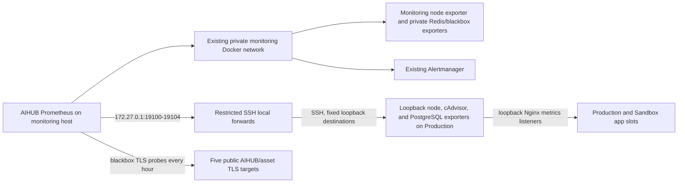

# AIHUB host and dependency observability

This runbook covers the host, container, shared PostgreSQL, Redis, and TLS signals requested by [#474](https://github.com/AiHub-Ecosystem/aihub-be/issues/474). It leaves the separate IELTS-writing monitoring worktree untouched. The AIHUB-owned overlay runs a separate Prometheus and sends alerts to the existing Alertmanager.

## Existing collectors audited

| Service             | Existing behavior                                                                                                                                                                                             | AIHUB Prometheus coverage                                                                                                                  |
| ------------------- | ------------------------------------------------------------------------------------------------------------------------------------------------------------------------------------------------------------- | ------------------------------------------------------------------------------------------------------------------------------------------ |
| `dashboard_backend` | Its FastAPI source has no `/metrics` route. `alerts_checker.py` runs application-level checks over `llm_usage_logs` for error rate, request spikes, latency, and daily cost, and sends Discord notifications. | No duplicate application alerts; #237 owns application metrics.                                                                            |
| `s3-vps-watchdog`   | Every 60 seconds it checks the SeaweedFS filer, S3, a public object, and the `s3.wispace.app` certificate; it exposes only loopback `/healthz` on port 9909.                                                  | No Prometheus metrics. Blackbox exports scheduled certificate samples for all five agreed hostnames so expiry can use the #474 alert rule. |

## Scrape path



The `monitoring` Docker network is the existing `172.27.0.0/16` bridge; its observed gateway is `172.27.0.1`. AIHUB Prometheus reserves `172.27.0.12` on that bridge so the host firewall can allow only this scraper. On the monitoring host, UFW allows TCP from `172.27.0.12` through the `monitoring` bridge to `172.27.0.1:9100` and `172.27.0.1:19100-19104`; its default-deny input policy blocks other sources. Redis is on the existing `redis_default` network. No exporter publishes a host port. Prometheus publishes only `127.0.0.1:9094`; operators reach it with an SSH local forward. Existing Prometheus, Grafana, Alertmanager, and their files are not recreated or modified. If this Docker network is recreated or its subnet changes, update the reserved address and matching firewall rules before restarting AIHUB Prometheus.

On Production, node_exporter listens on `127.0.0.1:9100`, cAdvisor on `127.0.0.1:19101`, postgres_exporter on `127.0.0.1:9187`, and Nginx exposes app metrics on loopback ports `19103` (Production) and `19104` (Sandbox). Those Nginx listeners proxy only the exact `/metrics` path to the active app slot; all other paths return 404. Public API and Sandbox listeners continue to return 404 for `/metrics`. The restricted key's `authorized_keys` `permitopen` list must allow only the five approved loopback destinations `9100`, `19101`, `9187`, `19103`, and `19104`. The monitoring-host tunnel binds the forwards to `172.27.0.1:19100-19104`. The SSH host key is pinned in a separate `known_hosts` file.

On the monitoring host, node_exporter listens on `172.27.0.1:9100`. Redis exporter and blackbox exporter have no published ports and join only their required private Docker networks. The certificate job probes `api.aihubproduction.com`, `sandbox.aihubproduction.com`, `aihubproduction.com`, `www.aihubproduction.com`, and `s3.wispace.app` once per hour.

Run the PostgreSQL exporter as the Production host's unprivileged account, and the Redis exporter and SSH tunnel as the monitoring host's unprivileged account. Set `AIHUB_PRODUCTION_UID_GID` and `AIHUB_MONITORING_UID_GID` to the corresponding numeric `id -u:id -g` values so each process can read its mode-0600 secret without running as root.
The SSH tunnel image creates a passwd entry for that monitoring UID/GID because OpenSSH requires one when run under a numeric account.

## Resource ceilings

| Host       | Services                                                                 | Memory ceiling | CPU ceiling |                             Persistent metrics |
| ---------- | ------------------------------------------------------------------------ | -------------: | ----------: | ---------------------------------------------: |
| Production | node_exporter, cAdvisor, postgres_exporter                               |        384 MiB |    0.45 CPU |                                           None |
| Monitoring | Prometheus, node_exporter, Redis exporter, blackbox exporter, SSH tunnel |        512 MiB |    0.70 CPU | 512 MiB TSDB retention-size target and 14 days |

Memory/CPU are hard container ceilings approved for this rollout. TSDB retention size bounds stored blocks but is not a filesystem quota; WAL can add disk usage. Record observed `docker stats` and host memory/disk before considering the budget satisfied.

## Secrets and data boundaries

Store monitoring credentials in Vault and provision host-side files under `~/aihub-monitoring/secrets` of the operator account, outside the checkout, with owner-only directory access. Compose files contain file paths only.

PostgreSQL uses a dedicated `aihub_monitoring` login that can execute one fixed `SECURITY DEFINER` function owned by `aihub_admin`. That function returns aggregate connection and lock counts plus `aihub`/`aihub_sandbox` sizes and transaction durations. It exports no SQL text or per-role activity and grants neither `pg_monitor` nor `pg_read_all_stats`. The postgres_exporter `v0.20.1` query extension is deprecated upstream; keep the image pinned and replace this compatibility path before upgrading past its support.

Redis uses a dedicated ACL user with only `PING`, aggregate `INFO`, `CLIENT SETNAME`, `LATENCY LATEST`, and `MEMORY STATS`. Key-reading and `CONFIG` commands are denied. The exporter reads its password from a mounted secret file. Do not change Redis `maxmemory` or its existing persistence policy for this collector. Its alert threshold assumes the observed 256 MiB `maxmemory` and must be reviewed if that value changes.

## Deploy and validate

Keep the Compose file, Prometheus config/rules, blackbox config, PostgreSQL aggregate query/function, and statement installer/report under `~/aihub-monitoring` of the operator account on each host. Keep `.env` and secret files outside that directory's tracked source if it is a checkout; set directory/file permissions before starting containers.

On Production, set `AIHUB_METRICS_BIND_IP=127.0.0.1`, `AIHUB_POSTGRES_EXPORTER_URI=127.0.0.1:5433/aihub?sslmode=disable`, the secret-file path, and `AIHUB_HOST_JOB_METRICS_DIR` to the operator's `~/.aihub-host-job-metrics` (absolute path). On the monitoring host, point `AIHUB_HOST_JOB_METRICS_DIR` at an empty directory. Enable `production` and `container-metrics` profiles. On the monitoring host, set `AIHUB_METRICS_BIND_IP=172.27.0.1`, the observed Redis address `redis://redis:6379`, the restricted SSH identity, and its pinned host key; enable the `monitoring` profile. The `.env` file on each host must satisfy Compose interpolation for the complete file, including fields for inactive profiles.

Before the tunnel starts, update the restricted key's `permitopen` entries and the monitoring-host UFW rule for forwarded ports `19103` and `19104`. Keep `sandbox-targets/targets.yml` aligned with `AIHUB_SANDBOX_ENABLED`: leave its target in place when Sandbox is enabled, and replace its contents with `[]` while Sandbox is disabled. Prometheus watches the mounted directory and updates the target set without a restart. Start Production exporters and monitoring-host node/Redis/blackbox exporters first. Verify their loopback or private-network `/metrics` endpoints. Start the restricted SSH tunnel and check all five forwarded endpoints when Sandbox is enabled, or the four active endpoints when it is disabled. Verify `curl http://127.0.0.1:19103/metrics` on Production, and verify other paths on that port return 404. When Sandbox is enabled, also check `curl http://127.0.0.1:19104/metrics` and verify other paths return 404. Check both public API hosts still return 404 for `/metrics`. Start `prometheus-aihub` last so the initial target set is available before alert evaluation.

Run the repository config checks before rollout:

```sh
pnpm test:monitoring-config
pnpm check:monitoring-config
```

On each host, also render the exact `.env` and profiles with `docker compose ... config`. On the monitoring host, run `promtool check config` and `promtool check rules` using `prom/prometheus:v3.13.4`; check the blackbox config with its pinned image. Do not touch the separate monitoring worktree.

Inspect `http://127.0.0.1:9094/api/v1/targets` through SSH. Every `aihub-*` target must be `UP`. Confirm samples for:

```promql
node_uname_info{job=~"aihub-(production|monitoring)-node"}
container_memory_usage_bytes{job="aihub-production-containers",name=~"aihub.*"}
aihub_postgres_snapshot_value{job="aihub-postgres",metric="connections_total"}
redis_memory_used_bytes{job="aihub-redis"}
redis_commands_duration_seconds_total{job="aihub-redis"}
probe_ssl_earliest_cert_expiry{job="aihub-certificate-expiry"}
probe_success{job="aihub-edge-health"}
aihub_host_job_last_success_timestamp_seconds{job="aihub-production-node"}
aihub_email_outbox_oldest_queued_age_seconds{job=~"aihub-(production|sandbox)-app"}
aihub_email_delivery_cancelled_timestamp_seconds{job=~"aihub-(production|sandbox)-app",reason="credential_expired"}
```

Also confirm the Postgres scrape exposes only the custom aggregate families and the Redis exporter has no key/config access. cAdvisor's read-only Docker and containerd sockets still give it root-equivalent runtime API access; its metric relabel filter keeps only container names beginning `aihub`.

From a workstation outside both hosts, probe `9100`, `9115`, `9121`, `9187`, `9094`, and `19100-19104` on both hosts. All must be closed or filtered while the host remains reachable. A `closed` result is valid for the loopback Prometheus UI; its operator access is through SSH. Ports `19103` and `19104` bind only to Production loopback and are reachable to Prometheus through the restricted SSH forwards.

Compare per-container `docker stats` and `free -m`/disk use with the ceilings above before and after rollout. Record the values and check that no unrelated container restarted. Certificate target configuration is hourly; verify a new sample on a later scrape as well as the initial sample.

## Alert thresholds and routing

The rule slice for this issue is listed in the [host/dependency alert catalog](alert-catalog.md), which is a scoped contribution to #412, not completion of the full #412 catalog. The existing Alertmanager currently routes `warning` to `discord-warning`, and `critical` to `discord-critical`, Pushover, and Telegram. Disk 80%, PostgreSQL connections 80% of measured `max_connections`, and certificate expiry within 14 days are issue-defined thresholds. The five-second clock bound, memory below 10%, Redis memory above 80% of the observed bound, Redis mean command latency above 100 ms, restart loop, and failed-probe severity are proposals for the #412 review. The owner approved collector and resource scope; this does not approve a general paging policy.

The Redis threshold is static because its exporter is explicitly forbidden from calling `CONFIG`. The target-down alert covers every `aihub-*` scrape job. Do not claim alert delivery has been exercised unless it was deliberately tested through the configured receiver route.

### Host disk

Use the `AIHUBHostDiskAbove80Percent` series to identify the host and mountpoint; confirm the filesystem with `df -h` over SSH before cleanup or expansion. Do not delete files from another service's data directory.

### Host memory

Use `AIHUBHostMemoryPressure` and `node_memory_MemAvailable_bytes`; compare with `free -m` and container usage before restarting a service.

### Host clock

Use `node_timex_offset_seconds` and `node_timex_sync_status` for Production and monitoring. `AIHUBHostClockUnsynchronizedOrOffsetAboveBound` warns when synchronization is lost or absolute offset exceeds the proposed five-second bound for one minute. Five seconds is below the 30-second TOTP step and the 60-second JWT/assertion skew allowance. Confirm the host's time-service state before changing its configuration; #412 owns the final alert-policy review.

### Containers

Use the cAdvisor `name` label to identify the affected `aihub...` container, then inspect `docker stats`, `docker ps -a`, and that container's restart history. cAdvisor has no stopped-container history, so its OOM/restart series are not a complete event log.

### PostgreSQL

Compare `connections_total` with `max_connections`; investigate the shared cluster using its approved operator workflow. The exporter function exposes counts and durations only, not SQL text or per-role activity.

#### Statement statistics and privacy gate

The read-only production check on 2026-10-16 found PostgreSQL 16.15 with an empty `shared_preload_libraries`, `compute_query_id=auto`, and `pg_stat_statements` 1.10 available but not installed in any connectable database. PostgreSQL last started at `2026-10-12 08:11:15 UTC`. The `aihub_monitoring` login exists, is a non-superuser, and is not a member of `pg_monitor` or `pg_read_all_stats`. The database container belongs to the separate Compose project `/home/VietHXQ/aihub`; #362 has not recorded its owner contact or a change-notification agreement. Do not change or restart it without a maintenance window coordinated with every affected application owner.

`pg_stat_statements` must be loaded through the cluster-wide `shared_preload_libraries` setting and requires a PostgreSQL restart. Loading it collects statement statistics across the shared cluster; install the extension only in `aihub` and `aihub_sandbox` ([PostgreSQL 16 documentation](https://www.postgresql.org/docs/16/pgstatstatements.html)). The current shared `aihub_admin` superuser is used by multiple applications (#298), so the cluster owner and affected application owners must review this data exposure before enabling it.

After the coordinated restart, verify the module is loaded and `compute_query_id` is not `off`, then run [`postgres-statements.sql`](../../ops/monitoring/postgres-statements.sql) separately in `aihub` and `aihub_sandbox` as `aihub_admin`. Its database guard rejects other databases. Verify the extension exists in those two databases only. The `aihub_monitoring.statement_stats()` `SECURITY DEFINER` function filters rows to the current database and returns only `queryid`, database name, calls, total execution time, and mean execution time. It never returns statement text. Do not grant `pg_monitor`, `pg_read_all_stats`, or direct access to query text.

Before accepting the privacy gate, review a sample of normalized statement text in a privileged, private session, filtered to one AIHUB database. Do not copy the text to a terminal transcript, issue, or report. PostgreSQL usually replaces constants with parameter markers, but may expose original constants when entries are frequently evicted; if a sample contains personal data or credentials, disable the feature and resolve the exposure before continuing. Record only pass/fail and the sample count ([normalization caveat](https://www.postgresql.org/docs/16/pgstatstatements.html)).

Use [`postgres-statements-report.sql`](../../ops/monitoring/postgres-statements-report.sql) with the `aihub_monitoring` login to produce separate top-20 lists by total and mean execution time. The report deliberately omits SQL text; `calls` provides context for high mean times. Preserve the cumulative statistics and do not reset them during verification.

### Redis

Check `redis_memory_used_bytes`, command latency, and the observed 256 MiB limit. Use the Redis operator's ACL-safe checks; do not enable key collection or `CONFIG` access to investigate an alert.

### Target health

Inspect `/api/v1/targets` through the loopback Prometheus tunnel and check the affected exporter and SSH forward. A target-down alert can indicate either source unavailability or the monitoring path.

### Certificates

Inspect the `probe_success` and `probe_ssl_earliest_cert_expiry` series for the named hostname. The probe runs hourly; a failed probe is distinct from an expiry threshold alert.

### Edge probe

The `aihub-edge-health` job (#291) asks the monitoring host's blackbox exporter to fetch, every 30 seconds through the public edge:

| Target                                       | When it fails                                                                         |
| -------------------------------------------- | ------------------------------------------------------------------------------------- |
| `https://api.aihubproduction.com/health`     | Production is unreachable for customers: DNS, TLS, nginx, or the active app slot.     |
| `https://sandbox.aihubproduction.com/health` | The same for the Sandbox tier.                                                        |
| `https://aihubproduction.com/`               | The Customer Web is down. Replace with its health route once AiHub-Frontend#94 lands. |

`AIHUBEdgeProbeFailed` fires after two minutes without a 2xx. `/health` is liveness only, so a process that answers but cannot reach Postgres or Redis still passes; the [authenticated Sandbox probe](#authenticated-sandbox-probe) covers that case. Read `probe_http_status_code` and `probe_duration_seconds` for the instance, then check the host with `ops/status.sh` ([deploy-vps.md](deploy-vps.md#checking-deployed-state)). The probe runs on the monitoring host, so that host being down silences it; the watchdog for that is #412's.

### Scheduled jobs

Every scheduled run of `scripts/ops/host-jobs/host-scheduled-job.sh` and `scripts/ops/backups/backup-postgres.sh` writes its result to `~/.aihub-host-job-metrics/<task>-success.prom` or `<task>-failure.prom` on Production (#291). Production's node exporter reads that directory with its textfile collector, so Prometheus on the monitoring host sees:

- `aihub_host_job_last_success_timestamp_seconds{task}` and `aihub_host_job_max_age_seconds{task}`, written on success;
- `aihub_host_job_last_failure_timestamp_seconds{task}`, written on failure.

| Task                                                                                         | Window before `AIHUBScheduledJobMissed` |
| -------------------------------------------------------------------------------------------- | --------------------------------------- |
| `quota`, `prune`, `ttl-audit`, `avatar-sweep`, `speaking-upload-sweep`, `notification-sweep` | 25 hours                                |
| `report`, `postgres-backup`                                                                  | 2 hours 20 minutes                      |
| `chart-upload-sweep`                                                                         | 50 minutes                              |
| `sandbox-mint-probe` (monitoring host, below)                                                | 5 minutes                               |

`AIHUBScheduledJobFailed` fires as soon as a run's failure is newer than its last success, and clears on the next success. `AIHUBScheduledJobMissed` fires when no success arrived inside the window, which covers a stopped cron, a schedule CD left suspended, a deferred run (`deferred reason=host_job_active` is not a failure), and a host that is down. Faster jobs get two cadences so one run skipped during a deploy does not page.

Manual reruns with `--from`/`--to`, `--month`, or `--dry-run` write nothing. For either alert, read the newest lines of the job's log ([deploy-vps.md](deploy-vps.md#scheduled-operator-jobs)); the failure detail is there, never in the metric. A task that has never succeeded has no series and cannot alert as missed; after adding a job, check that its success series appears.

### Authenticated Sandbox probe

`scripts/ops/monitoring/probe-sandbox-mint.sh` runs every minute from the monitoring host's crontab, between the `AIHUB SANDBOX PROBE` markers, and mints a Sandbox assertion through the public edge (#291). The mint looks up the API key (Redis cache or Postgres), takes a Redis rate-limit slot, and reads the Organization's identity configuration from Postgres, so it fails when the process answers `/health` but its dependencies are gone. It calls no AI service, consumes no quota, and writes only the key's throttled `last_used_at`.

It reports as task `sandbox-mint-probe` in the scheduled-job format to the monitoring host's node exporter (`AIHUB_HOST_JOB_METRICS_DIR` there), so `AIHUBScheduledJobFailed` fires on a failed mint after one retry and `AIHUBScheduledJobMissed` after five minutes without a success. A failure is logged to `~/aihub-sandbox-probe.log` with the HTTP status and the API error code only.

Host setup, once:

- An internal key in the Sandbox allowlist Organization, issued with `key:create --scopes writing.grade --envs sandbox --internal true` ([sandbox-provisioning.md](sandbox-provisioning.md)), stored in `~/aihub-monitoring/secrets/sandbox-probe-api-key` with mode `0600`. Pipe the command's stdout straight into that file; never print the key.
- The script copied to `~/aihub-monitoring/ops/probe-sandbox-mint.sh`, mode `0755`, and the crontab line `* * * * * $HOME/aihub-monitoring/ops/probe-sandbox-mint.sh >/dev/null 2>&1`.

A `403 FORBIDDEN` means the key's Organization left `AIHUB_SANDBOX_ORG_IDS`; a `401` means the key was revoked. Issue a new key rather than widening the allowlist.

## Deployment evidence

2026-10-18: the AIHUB Prometheus container had been stopped since the monitoring host's reboot on 2026-10-16 at 14:12 UTC. It exited cleanly and did not come back, although every exporter did. For about two days none of the rules in the [alert catalog](alert-catalog.md) were evaluated, and nothing reported it: a stopped Prometheus cannot fire its own target-down alert. It was started again on 2026-10-18; all six non-certificate targets were `UP` and all 11 rules loaded and inactive. A watchdog outside this Prometheus is tracked in #412. After any monitoring-host reboot, check that `prometheus-aihub` is running.

On 2026-10-16, a temporary `AIHUBAlertDeliveryTest` warning alert was accepted by Alertmanager's v2 API (`HTTP 200`) and routed to `discord-warning`. During the 35-second observation window, the Discord notification-latency sample count rose from 209 to 211 and Discord notification failure counters remained zero. The canary was absent from the active alert groups after its five-minute expiry. These are aggregate counters and do not confirm a human saw the message. Critical/Pushover/Telegram receivers were not exercised.

2026-10-16 rollout: UFW is active with default-deny input and allows only Prometheus `172.27.0.12` over bridge `br-21a4afb75b60` to gateway `172.27.0.1` on TCP `9100` and `19100-19102`. AIHUB Prometheus now reserves `.12`; access from another monitoring-network container timed out while the configured Prometheus container reached all four exporter endpoints. The AIHUB Prometheus UI and candidate exporter ports `9094`, `9100`, `9115`, `9121`, `9187`, and `19100-19102` were closed/filtered from the operator workstation on both hosts. Production Docker reports the `overlayfs` containerd snapshotter, so cAdvisor also mounts the read-only containerd socket; both runtime sockets remain root-equivalent access.

Prometheus returns two `node_uname_info` series and two clock offset/synchronization series (both hosts report synchronized; Production offset 0 seconds and monitoring offset about -1.7 ms), eight `aihub...` container memory series, one PostgreSQL connection sample, one Redis memory sample, and Redis command-latency series. All six non-certificate AIHUB scrape targets are `UP`. During the 2026-10-16 post-deploy check, Prometheus reported all five certificate targets `UP`; range queries over the hourly samples returned `probe_success=1` and `probe_ssl_earliest_cert_expiry` for every hostname, with sample ages below 38 minutes. Use a range query such as `probe_success{job="aihub-certificate-expiry"}[70m]` and confirm `lastScrape` in `/api/v1/targets`; an instant query can omit hourly samples between scrapes.

At the sample, Production had 3.3 GiB available RAM, no swap, and 28% disk use; its three exporters used about 122 MiB together. Monitoring had 1.8 GiB available RAM, no swap, and 60% disk use; its five AIHUB monitoring containers used about 66 MiB together. Both resource sets are below the approved container ceilings. The 16 candidate exporter/UI TCP ports were closed or filtered from the operator workstation on both hosts. The dedicated PostgreSQL aggregate query and Redis ACL boundary were verified during rollout; Redis key and configuration commands remain denied.

Do not record secrets, raw connection strings, or IPs from request data here.

## Close criteria for #474

- Existing dashboard and watchdog behavior is recorded above, with their app-level work not duplicated.
- Production and monitoring host metrics, AIHUB container metrics, shared PostgreSQL metrics, and AIHUB Redis metrics are `UP` with expected samples.
- Both hosts expose clock offset and synchronization status, with the clock alert listed in the #412 catalog.
- No exporter or Prometheus UI is reachable from the internet; outside-port results are recorded.
- The certificate job completes an hourly scrape for all five agreed hostnames and emits fresh expiry data.
- `pg_stat_statements` is enabled and privacy-checked after a shared-cluster restart coordinated with all affected service owners.
- The monitoring role can read only AIHUB database/queryid timing fields through the restricted function; the top-statements report contains no SQL text.
- All #474 rules have entries in the #412 alert catalog.
- PostgreSQL and Redis access is verified at the restricted-function/ACL boundary.
- Measured service and host resource use fits the approved ceilings.
